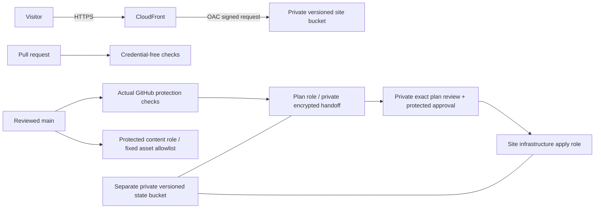

# ResumeOps

A small professional resume in semantic HTML, CSS and vanilla JavaScript, backed by Terraform for private S3 + CloudFront and GitHub Actions with OIDC. The supplied resume is the content baseline. The user has authorized private GitHub source verification only. AWS operations, public publication and merge remain prohibited.

Private verification preparation, 2026-11-25:

| Gate | Current verdict |
|---|---|
| Local Windows environment | **NO-GO** — provider TLS certificate substitution persists. |
| Implementation based on independent CI | **NO-GO / pending** — both-root hosted validation has not executed yet. |
| Private repository verification | **NO-GO / pending** — the private repository has been created and verified; reviewed source push and actual hosted results are pending. |
| Public repository publication | **NO-GO** — not authorized. |
| Live AWS release | **NO-GO** — not authorized; mandatory live proofs absent. |

> Private Ubuntu CI verification is now explicitly authorized by the user (2026-11-25), including creation of a private `resumeops` repository and reviewed source commits/pushes. Public publication, AWS credentials/resources/IAM and Terraform apply/destroy remain prohibited. The approved SPEC amendment permits independently inspected successful credential-free CI validation of both pinned roots as the implementation gate; Windows remains a separate environment verdict. At this preparation point no hosted CI success is claimed. The private repository is `https://github.com/keboxxerxes/resumeops`; its visibility was verified as private, with zero initial repository secrets and zero registered workflows before source push. Only `ci.yml` is executable; the three operational workflows are inert source under `workflow-templates/` and cannot be dispatched or scheduled. Restoration requires a separately authorized enabling change.

The provider advertises a self-signed certificate, but a verified Windows local client receives a different certificate and fails closed. The component responsible remains unidentified. An independently verified successful Ubuntu CI run can satisfy implementation validation without relabeling Windows as healthy. Dependency constraints and lockfiles stay unchanged. See [SPEC amendment](SPEC.md), [diagnosis](docs/MTLS_DIAGNOSTICS.md), [15-exception review](docs/EXCEPTION_REASSESSMENT.md), [final assessment](FINAL_ASSESSMENT.md) and [tests](TEST_RESULTS.md).

## Architecture



Only production persists. `infra/bootstrap` owns state storage, exact GitHub OIDC roles and the account-wide USD 5 budget; `infra/site` consumes `infra/modules/website`. The site root cannot destroy bootstrap. No domain, backend, database, analytics, external fonts, containers, Kubernetes, AI runtime, EC2, NAT, ALB, customer-managed KMS key or Route53 is required.

## Local checks

Requirements: Git, Node 24.22.2, Python 3.10+, Terraform 1.17.2. Exact AWS provider 6.74.0 and both provider lockfiles are committed source deliverables. Checkov 3.4.11, TFLint 0.66.0, actionlint 1.7.12 and Gitleaks 8.30.1 are pinned. Browser dependency versions are in the npm lockfile. Downloaded CLIs are verified against official upstream checksum manifests; see `scripts/install-tools.py` and `docs/DEPENDENCIES.md`.

On Linux/macOS-like shells (CLI installer currently targets Linux amd64 or Windows amd64):

```sh
python3 scripts/install-tools.py
python3 -m venv .tools/venv
.tools/venv/bin/pip install -r requirements-tools.txt
npm ci --ignore-scripts
npx playwright install chromium
terraform fmt -check -recursive infra
for root in infra/bootstrap infra/site; do
  terraform -chdir="$root" init -backend=false -input=false -lockfile=readonly
  terraform -chdir="$root" validate -no-color
  .tools/tflint --chdir="$root" --config="$PWD/.tflint.hcl"
done
.tools/venv/bin/checkov -d infra --framework terraform --compact --quiet
.tools/actionlint
.tools/gitleaks dir . --redact --no-banner
.tools/venv/bin/python scripts/security.py
.tools/venv/bin/python tests/negative-scans.py
node --test tests/security.test.mjs
npm test
```

Windows equivalents use `.tools/*.exe`, `.tools/venv/Scripts/python` and `.tools/venv/Scripts/python .tools/venv/Scripts/checkov`. Use a workspace-local npm cache if the default profile cache is inaccessible. This session installed Chromium in `.tools/browsers`; set `PLAYWRIGHT_BROWSERS_PATH` to its absolute path for reuse. Keep TLS verification enabled; this session used an ignored PEM bundle exported from the Windows ROOT/CA stores for Python pip and `NODE_EXTRA_CA_CERTS` for browser downloads.

`npm test` starts and stops its own loopback-only static server. For a manual private preview, `node tests/serve.mjs` is a test helper, so use `python -m http.server 4174 --bind 127.0.0.1 --directory site` and stop it afterwards. Browser test screenshots stay ignored in `test-results/`. Local metadata deliberately says preview; CI creates the deployed content SHA/date.

## Windows limitation and approved validation alternative

Use a trusted, separately authorized execution environment that preserves the provider's process-specific mTLS channel. Do not trust the substituted certificate, disable verification, change pins, or restart security/WSL services to manufacture a pass. On Windows with the documented verified mirror prerequisites, `python scripts/diagnose-provider-mtls.py` produces sanitized diagnosis only: exit 1 means TLS failed/substitution observed, 2 means diagnostic incomplete, and 0 requires verified pinned TLS. It is not Terraform validation.

In the approved environment, retain Terraform **1.17.2**, AWS provider **6.74.0**, and both checked-in candidate lockfiles. Run these actual checks, then have the independent reviewer repeat them:

```sh
terraform fmt -check -recursive infra
for root in infra/bootstrap infra/site; do
  terraform -chdir="$root" init -backend=false -input=false -lockfile=readonly
  terraform -chdir="$root" validate -no-color
done
```

Every command must exit 0. A core-only control, scanner, copied provider cache or successful init cannot substitute for either real root validation. The readonly-mirror init warning observed here did not modify either lockfile; their fingerprints and all version constraints remain unchanged. Once validation passes, rerun the complete applicable suite and reassess the three gates. Publication approval and AWS deployment approval remain separate human decisions. Current Windows/WSL blockers remain unresolved. Successful both-root validation on the exact reviewed commit in credential-free GitHub-hosted Ubuntu CI is now an approved alternative; until actual independently reviewed results exist, no Linux validation success is claimed.

## Authorization and repository preparation

Do not enable live workflows or run the following AWS commands until explicit human authorization covers IAM, billable resources and publication of the resume content. Keep the checkout/repository private until sanitization and personal-content approval. No repository identity is assumed and no unknown repository link is rendered.

1. Select the actual repository and GitHub plan. Configure protected `main`: require at least one current approving PR review, dismiss stale approvals, require approval of the most recent reviewable push, enforce administrators, disallow bypass users/teams/apps, require strict `verify` CI. Review all Terraform/workflow/script changes before merging.
2. Configure environments `production-plan`, `production-apply`, `production-content`, `production-drift`. Every environment must have required reviewers, prevent self-review, disallow administrator bypass and use **custom deployment branch policies with exactly one branch policy `main`, no tag policies**. Scheduled drift consequently requires protected approval too; this is intentional fail-closed operation. An unavailable reviewer feature is a blocker: private repository plan support must be verified, not assumed. Never make the repository public merely to unlock a feature without separate publication authorization.
3. Create a fine-grained GitHub token with read-only repository administration access sufficient to GET environment/branch protection APIs, stored as `GH_PROTECTION_TOKEN` in each environment. It is a GitHub verification credential, never an AWS credential. Limit it to this repository; rotate it. `scripts/gate.mjs` rejects inaccessible API responses, permissive policies, missing checks and stale workflow revisions **before requesting OIDC credentials**. API failure is NO-GO.
4. Keep `ALLOW_AWS_OPERATIONS` unset until every prerequisite is complete and human authorization is recorded. All live jobs require its exact repository-variable value `true` and the current `refs/heads/main` SHA. Existing workflow runs become stale when main moves and must be rerun.

Environment OIDC subjects replace the branch component; AWS cannot see the branch in that subject. Exact AWS trust plus actual API-proven main-only environment rules supply both boundaries. Runtime roles have no IAM, role chaining or bootstrap access. They can access only the exact site state key and its lockfile; plan/drift can read state and write/delete the lockfile, while apply can write state but cannot delete it. Content has no state or infrastructure administration permissions.

## Future separately authorized bootstrap and first deployment

These are instructions for a human operator, not evidence that deployment happened. Use authorized local short-lived AWS SSO credentials, never access keys in repository files or workflow secrets. Use private terminal capture/storage; Terraform output, plans and state may contain account IDs or contact details. Do not paste them into public issues, logs or artifacts.

On Windows PowerShell, use `New-Item -ItemType Directory -Force .local` instead of `umask`/`mkdir -p`, and enter the recipient privately with `$env:TF_VAR_alert_email = Read-Host 'Private budget recipient'` so its value is absent from command history. Run in a private local terminal after authorization; keep the workspace accessible only to the operator and secure private files using the operator's normal encrypted storage/ACL controls. The Terraform commands and relative paths below also work in PowerShell.

1. In a private untracked variable file (for example `.local/bootstrap.tfvars`), copy `infra/bootstrap/bootstrap.example.tfvars`, replace name/repository, and provide the budget address through private `TF_VAR_alert_email`. Inspect whether this AWS account already has a GitHub OIDC provider; set `existing_oidc_provider_arn` privately if so. Bootstrap never automatically imports/changes another provider. The unique `name` determines exact state and site bucket names.
2. Initialize bootstrap with **local state**, then create a saved plan, inspect that exact plan privately and apply only after human approval:

```sh
umask 077
mkdir -p .local
terraform -chdir=infra/bootstrap init -input=false
terraform -chdir=infra/bootstrap plan -var-file=../../.local/bootstrap.tfvars -out=../../.local/bootstrap.tfplan
terraform -chdir=infra/bootstrap show ../../.local/bootstrap.tfplan
terraform -chdir=infra/bootstrap apply ../../.local/bootstrap.tfplan
```

3. Preserve the initial local bootstrap state and its backup in encrypted private operator storage. Create ignored `infra/bootstrap/backend.tf` containing `terraform { backend "s3" {} }` (multiline HCL is also fine). Copy the backend example into a private file and set the created state bucket, `bootstrap/terraform.tfstate`, encryption and `use_lockfile=true`. Then migrate:

```sh
terraform -chdir=infra/bootstrap init -migrate-state -backend-config=../../.local/bootstrap.s3.tfbackend
```

Verify the remote object/version and native lock through authorized tests before securely retiring old local copies. Never use the site state key for bootstrap and never use Terraform workspaces. Reinitialization on another machine uses the same private bootstrap backend configuration. Bootstrap bucket `prevent_destroy` is a second guard; don't remove it during site teardown.

4. Create `.local/production.tfvars` from the site example and `.local/production.s3.tfbackend` from its backend example. Site bucket must equal `<bootstrap name>-production`; backend key must equal `site/production/terraform.tfstate`. **First CloudFront creation is an authorized local-operator action**, avoiding runtime wildcard create/tag permissions:

```sh
terraform -chdir=infra/site init -backend-config=../../.local/production.s3.tfbackend
terraform -chdir=infra/site plan -var-file=../../.local/production.tfvars -out=../../.local/first-site.tfplan
terraform -chdir=infra/site show ../../.local/first-site.tfplan
terraform -chdir=infra/site apply ../../.local/first-site.tfplan
```

5. Privately read site state to obtain the exact distribution, origin access control and response headers policy IDs. Set bootstrap private inputs `content_distribution_id`, `origin_access_control_id`, `response_headers_policy_id`; review and apply a fresh exact bootstrap saved plan. Runtime CloudFront mutation permissions are bound to those exact IDs and otherwise point at an impossible `NOTCONFIGURED` target. Runtime roles **cannot create or retag arbitrary CloudFront resources**. Replacement/recreation requires newly authorized local creation and rebinding. CloudFront read and mutation permissions both use those exact IDs; no credentialed runtime workflow can operate until the operator binds them.
6. Configure private environment secrets: `STATE_BUCKET`, `SITE_BUCKET`, `PLAN_ROLE_ARN` (plan/drift), `APPLY_ROLE_ARN`, `CONTENT_ROLE_ARN`, `CF_DISTRIBUTION_ID`, `SITE_HOST` (default `*.cloudfront.net`) as applicable; repository variable `AWS_REGION`. Use the same random 32-byte base64 `PLAN_ENCRYPTION_KEY` in protected production-plan and production-apply environments. Generate/store it privately through a password manager or secure stdin, not shell arguments/logs. No AWS static keys. Store no state, plan, email or account-specific values in tracked files.
7. After separate publication approval, enable `ALLOW_AWS_OPERATIONS=true`. Dispatch Content deployment at main, approve its environment, and verify HTTPS, headers, default root and exact metadata. Add the real public repository link only after its actual public URL is known and approved.

## Future separately authorized infrastructure changes and destruction

Dispatch Infrastructure from current main with `apply` or `destroy`. Destroy additionally requires exactly `DESTROY production SITE ONLY`; blank/wrong input fails. The protected plan job verifies live repository controls, runs a fresh private site plan, prints only its SHA256 digest and encrypts the binary with AES-256-GCM. Only `candidate.enc` is uploaded, with one-day retention. No plaintext Terraform plan/state/log is uploaded. Same-run download, authenticated decryption, digest/revision/operation checks and a 24-hour freshness limit prevent substitution/replay.

Before approving `production-apply`, the authorized reviewer downloads **that run's encrypted-plan artifact**, obtains the encryption key privately and decrypts locally into ignored private storage. Set private `PLAN_ENCRYPTION_KEY`, `GITHUB_SHA` to the run's exact SHA, and `OPERATION` to its exact operation, then run:

```sh
node scripts/plan-crypto.mjs review .local/candidate.enc .local/review.tfplan
terraform -chdir=infra/site show ../../.local/review.tfplan
```

Compare the verified SHA256 digest with the plan job, inspect the substantive private plan, and only then approve the apply environment for that same workflow run. **A digest alone is not plan review.** Approval occurs after candidate generation. If main changed, protection checks fail. If the candidate expires, run the workflow again and review the new candidate. Keep the key separate from artifacts, delete local plaintext and encrypted handoffs after review, and rotate the key on compromise. GitHub stores only authenticated ciphertext, though authorized reviewers with the key can access sensitive plans. Never publish decrypted plans or state.

The archived production workflow templates share concurrency group `resumeops-production`, with cancellation disabled. GitHub serializes running operations; it may replace an older pending run with a newer pending one. Human operators must also coordinate local Terraform sessions, honor S3 locks and never force-unlock without investigating ownership.

## Content rollback, drift and recovery

Content deployment accepts an optional exact 40-character main-ancestor SHA. Leave blank for current main. The workflow itself and its tooling always run from current trusted main. It extracts only regular `site/index.html`, `styles.css`, `app.js` from the chosen revision, generates fresh `{sha,date}` metadata and uploads only those assets plus metadata; no historical scripts execute. Protected approval authorizes the chosen prior content. Review rollback content before approval. Uploads use explicit types and revalidation headers. Invalidate only `/`, `/index.html`, `/styles.css`, `/app.js`, `/deployment.json`, wait, then verify HTTPS headers and metadata. Content uploads are not atomic; failed smoke checks require operator rollback/redeployment. They cannot silently establish a successful release.

Weekly and manual drift uses the read-only plan role: exit 0 = no drift, 2 = detected drift (reported and workflow fails visibly), 1/other = error/unknown (fails). Drift never applies. Review privately and dispatch a newly reviewed infrastructure plan to remediate. Scheduled workflow approval is intentional; if unattended read-only drift becomes desirable, changing protection policy requires human approval and a threat-model update.

State recovery: pause live workflows by removing `ALLOW_AWS_OPERATIONS`, coordinate operators, preserve current versions privately, verify there is no active lock, restore the correct prior state object version **only after explicit authorization**, refresh/plan privately and inspect for unintended changes before any apply. Lock contention, deny tests, restore, rollback, deployment, origin privacy and teardown all require actual authorized AWS verification; see test matrix.

## Teardown order

After explicit destruction authorization: disable content scheduling/dispatch access as appropriate, review a site-only destroy candidate, approve the protected exact-plan apply. S3 `force_destroy=false` means the site bucket will refuse deletion while object versions exist. An authorized local operator must separately review and remove **only that exact site bucket's objects, delete markers and versions** before retrying a fresh reviewed destroy plan. This is deliberate data-loss protection; no blanket automatic purge is provided. CloudFront must be disabled/deleted before the origin bucket; Terraform dependencies enforce this order. Verify site resources absent and bootstrap/state retained. Recreating CloudFront later requires authorized operator creation and exact-ID IAM rebinding.

Do not destroy bootstrap/state in this workflow. Separate later human authorization is required to remove roles, OIDC provider (only if owned/unused), budget, bucket protection and versioned bootstrap/state data. Keep final private state/recovery evidence first. Do not remove a shared provider. Removing `prevent_destroy` is a deliberate separately reviewed operator change.

## Cost and privacy

Target: **below USD 1/month at low traffic; never a cap**. An illustrative conservative pay-as-you-go month, before free allowances: 0.1 GB S3 Standard x USD 0.023/GB ~USD 0.0023, 1,000 PUTs ~USD 0.005, 10,000 GETs ~USD 0.004, 1 GB North American CloudFront delivery ~USD 0.085, 10,000 HTTPS requests ~USD 0.01: around USD 0.11 plus state/request/version overhead and taxes. These are an estimate, region/request mix matter. Keep retained site history 30 days and state history 90 days; no excessive invalidations or visitor logging. Missing S3/CloudFront access logs mean request-level and state-read auditing is absent; delivery smoke tests do not replace audit evidence. Native locks prevent concurrent state writes but do not monitor state changes. Versioning is not regional disaster recovery; an operator-maintained private recovery backup must be established and verified before release. GitHub plan/runner costs are separate and depend on account eligibility.

Official sources checked 2026-11-25: [S3 pricing](https://aws.amazon.com/s3/pricing/), [CloudFront pricing](https://aws.amazon.com/cloudfront/pricing/), [AWS Budgets pricing](https://aws.amazon.com/aws-cost-management/aws-budgets/pricing/). CloudFront pay-as-you-go allowances and newer flat-rate plans are distinct; this Terraform uses ordinary pay-as-you-go distribution configuration and does not claim enrollment in a flat-rate plan. Operator must recheck current prices, free allowance eligibility, geography and projected traffic before authorization; traffic spikes can exceed the target.

Terraform's account-wide USD 5 monthly cost budget sends **ACTUAL** spend threshold notifications when crossing USD 1/3/5 to the private operator input. Other AWS usage counts, notifications may be delayed and do not stop charges. Verify recipient confirmation/delivery live. Budget address remains in private state, so state/plan secrecy matters. No account IDs or role ARNs are printed by project scripts; AWS action account masking enabled. Avoid pasting raw provider errors into public evidence.

[Scanner exceptions](docs/SCANNER_EXCEPTIONS.md) explain each intentionally excluded logging, replication, WAF, KMS, custom certificate and geo restriction check per resource. SSE-S3 lacks independent KMS key-policy separation; AWS-managed KMS key storage itself is free, while customer-managed key storage and KMS requests may incur charges. Pay-as-you-go WAF costs exceed the target; the separate free flat-rate WAF offering is not enabled by this stack. S3 log delivery itself is free, with storage/access charges; omitting it is an explicit scope/privacy/audit tradeoff. The default CloudFront certificate's viewer TLS policy is AWS-controlled and supports older TLS; this residual is explicit, while HTTPS redirect and restrictive response headers are enforced. No false claim of custom TLS policy is made.
