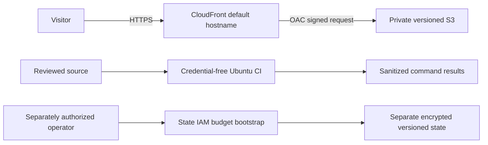

# Architecture

ResumeOps is a standalone static professional portfolio. [Approved content](../requirements/RESUME_CONTENT.md) is the source of resume facts; it omits private email, phone and the original PDF. The page provides a career timeline, competencies with in-progress skills labelled, education and project architecture. Local CSS/system fonts and vanilla JavaScript avoid trackers and remote runtime dependencies. Deployment metadata is text-only and remains an honest preview until a real authorized content deployment generates a source SHA/date.

## Runtime and source layout

| Path | Responsibility |
|---|---|
| `site/` | Four allowlisted static assets: HTML, CSS, JavaScript, deployment JSON |
| `infra/bootstrap/` | Separate state bucket, exact GitHub OIDC roles and budget |
| `infra/site/` | Explicit production root and distinct backend key |
| `infra/modules/website/` | Reusable private S3/CloudFront/OAC/header configuration |
| `.github/workflows/ci.yml` | The only executable workflow; verification only |
| `workflow-templates/` | Inert future infrastructure, content/rollback and drift workflows |
| `scripts/`, `tests/` | Verification, guarded operational tooling and negative/adversarial/browser cases |
| `docs/evidence/` | Essential structured history, provider provenance and cleanup inventory |

Only production is persistent. Temporary environments need separate authorization, unique resource names/state keys and controlled teardown; no persistent development stack was added. The default CloudFront hostname avoids paid domain/DNS resources. No EC2, NAT, ALB, Route53, paid customer KMS key, database or backend is required.

## Infrastructure boundaries

The origin has all S3 public-access blocks, bucket ownership enforcement, explicit SSE-S3, versioning and an HTTPS deny policy. CloudFront uses always-signed OAC requests and a bucket policy scoped to its distribution ARN; default root, HTTPS redirect and restrictive response headers/CSP are configured. Site noncurrent versions expire after 30 days.

Bootstrap state is separate, encrypted/versioned, publicly blocked and protected by `prevent_destroy`; its noncurrent versions are bounded at 90 days. Native S3 lockfiles replace any need for DynamoDB. Use distinct explicit keys `bootstrap/terraform.tfstate` and `site/production/terraform.tfstate`, never Terraform workspaces. Site destruction cannot delete bootstrap resources or state.

Plan/drift reads the exact site state and can modify only its precise lock object. Apply can write that state but cannot delete it, administer IAM or change bootstrap. Content can write four explicit object keys and invalidate the exact distribution. Runtime CloudFront reads/mutations bind to exact distribution/OAC/header-policy IDs. To avoid broad create/retag escalation, first creation and later replacement belong to a separately authorized local Linux operator, followed by exact-ID rebinding through bootstrap.

## Delivery and operations

Current CI has `contents: read`, SHA-pinned actions, credential persistence disabled, timeouts, no OIDC/AWS authentication/backend/plan/apply/destroy path, and a three-day sanitized-results artifact. Each required command's actual exit status is recorded even if an earlier check fails. Any failure makes the job fail; readonly initialization and per-run lock immutability remain mandatory.

The inert templates preserve future controls: current reviewed main and actual GitHub protection API checks before OIDC; exact environment subjects/audience; human review of a substantive private plan before post-plan apply approval; authenticated encrypted same-run handoff with SHA/digest/operation/age checks; shared non-cancelling production concurrency; typed site-only teardown; read-only drift with distinct 0/1/2 handling. Missing protected-environment features fail closed. Single-maintainer governance requires PRs and successful strict CI before main merges, with zero mandatory human PR approvals. The owner remains a required deployment reviewer and may explicitly approve their own protected run; administrator bypass and tag deployments remain prohibited. Independent AI SDD verification is not independent human approval. See the policy fields and residual risk in [deployment](DEPLOYMENT.md) and [security](SECURITY.md).

Content rollback uses current trusted tooling to extract only regular allowlisted assets from an approved main-ancestor revision. It never executes historical runner scripts. Metadata is regenerated, mutable paths invalidated, then HTTPS/headers/revision checked. Uploads are not atomic, so failures require deliberate rollback/redeployment. See [deployment](DEPLOYMENT.md) and [security](SECURITY.md).
